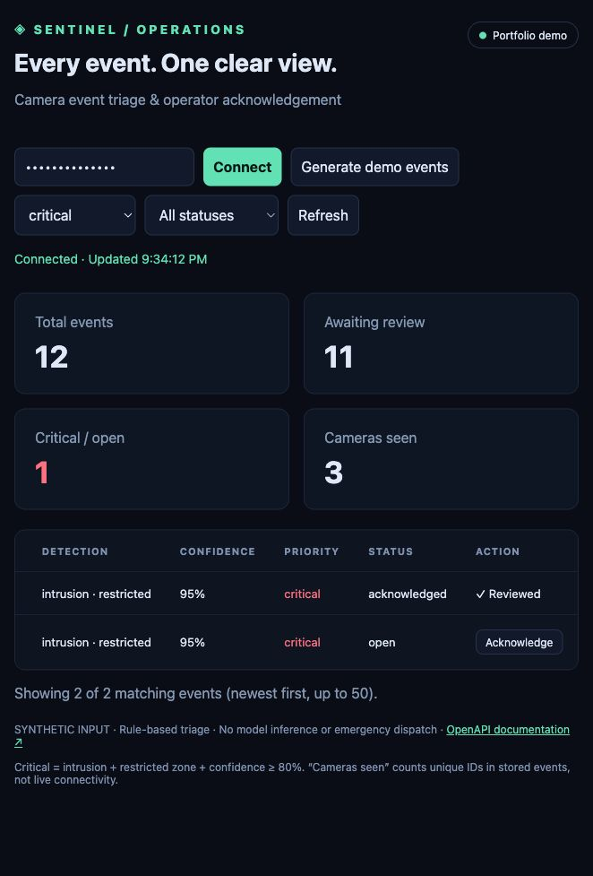
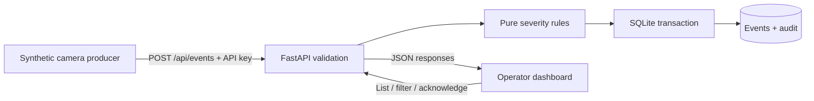

# Sentinel Event Hub

**Status:** 21 tests passed locally · CI workflow template included

A small, testable camera-event triage service: receive detections, assign priority, and let an operator acknowledge incidents without losing history.

**Python · FastAPI · SQLite · REST · Docker · pytest · GitHub Actions**



## Why this project

Video systems deliver more than model predictions: downstream software must validate events, tolerate retries, preserve state, and support human review. This portfolio prototype demonstrates those fundamentals with synthetic camera metadata. It is inspired by video-security workflows and is not affiliated with Motorola Solutions.

**Scope:** simulated detection events only. No camera feed, trained model, object detection, facial recognition, or emergency dispatch. A confidence value is input metadata, not a calibrated probability or a measured model result.

## Start locally (Python 3.11+)

```bash
git clone https://github.com/nhan-hoang26/sentinel-event-hub.git
cd sentinel-event-hub
python3 -m venv .venv
source .venv/bin/activate
pip install -r requirements-dev.txt
export SENTINEL_API_KEY="$(python -c 'import secrets; print(secrets.token_urlsafe(32))')"
uvicorn app.main:create_app --factory --host 127.0.0.1 --port 8000
```

Open [localhost:8000](http://127.0.0.1:8000), enter the value of your local `SENTINEL_API_KEY`, click **Connect**, then **Generate demo events**. Filter by `critical` and acknowledge an event. API docs: [localhost:8000/docs](http://127.0.0.1:8000/docs). API calls require the `X-API-Key` header; Swagger's “Try it out” accepts it as a header parameter.

The generated key is available in the terminal environment you started the server from. Use `printf '%s\n' "$SENTINEL_API_KEY"` there to copy it into the local dashboard; never commit it.

## Docker

```bash
cp .env.example .env
# Edit .env and replace the sample value with a random local key.
docker compose up --build -d
# Open http://127.0.0.1:8000 and use the same key.
docker compose logs -f
docker compose down
```

SQLite persists in a named volume. `docker compose down` retains it. The container runs as a non-root user, exposes a health check, and binds the host port to loopback. The Python path above is also supported if Docker is unavailable.

## Replay and prove retry safety

In another terminal with the same key exported:

```bash
python scripts/simulate.py --run-id interview
python scripts/simulate.py --run-id interview
```

The first run creates 12 events; the second returns 12 duplicates with HTTP 200 and leaves the total unchanged. Reusing an ID with changed content returns HTTP 409.

## Architecture



- **Domain:** `app/domain.py` defines typed inputs and pure triage rules.
- **Persistence:** `app/store.py` owns transactions, parameterized SQL, indexes, and audit records.
- **Transport:** `app/main.py` exposes REST, authentication, validation, readiness, and request IDs.
- **Presentation:** a dependency-free HTML/JS dashboard uses the same public API as the simulator.

### Rules and state

| Input | Severity |
|---|---|
| Intrusion + exact zone `restricted` + confidence ≥ 0.80 | critical |
| Camera offline | warning |
| Other valid event | info |

`open → acknowledged` is the only state transition. An acknowledgement is an operator action, not proof that a physical incident is resolved. Repeated acknowledgements return the same state and do not create extra audit entries.

### Reliability decisions

1. `event_id` is a primary key. `BEGIN IMMEDIATE` serializes the read/check/write sequence, preventing simultaneous retries from inserting duplicates.
2. An identical parsed payload is a retry; a changed payload under the same ID is a conflict. Timestamp strings are compared after Pydantic serialization; clients should replay the same timestamp representation.
3. Event insertion and its audit entry commit together. The same holds for acknowledgement and its audit record.
4. SQLite WAL supports readers alongside a writer. The 10-second busy timeout is bounded; there is no durable broker or background queue.
5. Lists use server receipt time and event ID as a deterministic tie-breaker. Offset pagination is simple but pages can shift when new events arrive.

## API

All `/api/*` routes require `X-API-Key`.

| Method | Route | Purpose |
|---|---|---|
| GET | `/health` | Database readiness; public, no event data |
| POST | `/api/events` | 201 new, 200 retry, 409 conflicting ID, 422 invalid input |
| GET | `/api/events` | Filter `severity`, `status`; bounded `limit` and `offset` |
| POST | `/api/events/{id}/ack` | Idempotent acknowledgement; 404 unknown event |
| GET | `/api/events/{id}/audit` | Ingestion/acknowledgement history; empty list for unknown ID |
| GET | `/api/summary` | Totals, open incidents, open critical incidents, unique camera IDs |

```bash
curl -X POST http://127.0.0.1:8000/api/events \
  -H "X-API-Key: $SENTINEL_API_KEY" -H 'Content-Type: application/json' \
  -d '{"event_id":"evt-001","camera_id":"cam-1","kind":"intrusion","confidence":0.95,"zone":"restricted","occurred_at":"2026-01-01T10:00:00Z"}'
```

## Verification

```bash
ruff check .
pytest -q
```

The suite covers authentication, fail-closed configuration, confidence boundaries, invalid data, timezone requirements, conflicting retries, concurrent retries, acknowledgement/audit atomic behavior, filters, pagination, request IDs, and persistence across application recreation. The included GitHub Actions template runs lint, tests, and a Docker image build on pushes and PRs after activation. The current publishing credential lacks the `workflow` scope, so it is stored at `docs/ci/github-actions.yml`; copy it to `.github/workflows/ci.yml` through an authorized GitHub session to activate CI. See [validation evidence](docs/VALIDATION.md) for what was actually run.

## Limits and next steps

This is a local educational prototype. A shared API key has no user roles or individual accountability. The audit table is transactional but not tamper-proof. There is no TLS termination, rate limiting, retention policy, metrics exporter, live camera heartbeat, or model evaluation pipeline. Do not expose it directly on the public Internet.

For deployment across replicas: move to PostgreSQL, introduce per-device authentication and operator RBAC, enforce request/body limits at a gateway, use cursor pagination, add schema migrations, and introduce a durable broker only when throughput or offline buffering requires it. Attach a real detector through a producer adapter while preserving the event contract; evaluate precision/recall and latency on labelled clips before making AI performance claims.

[Vietnamese interview guide and CV wording](docs/INTERVIEW_VI.md) · [Design decisions](docs/DECISIONS.md)
